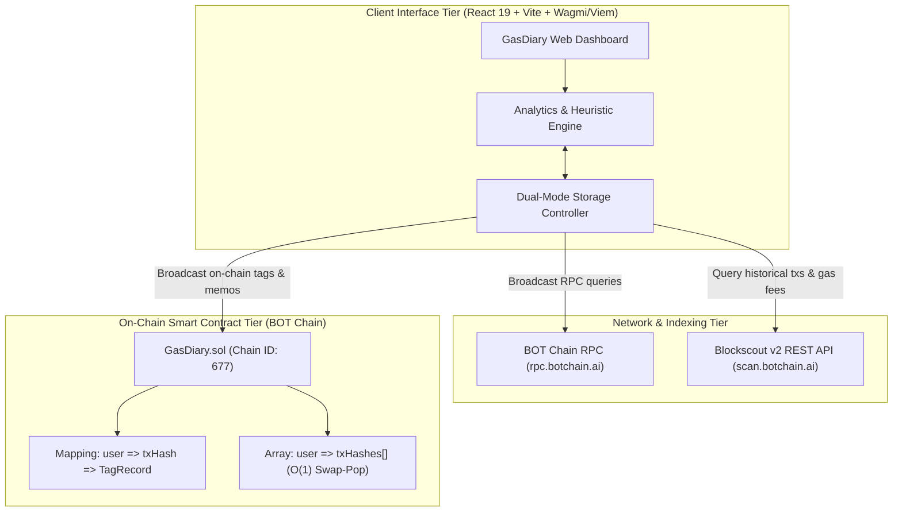
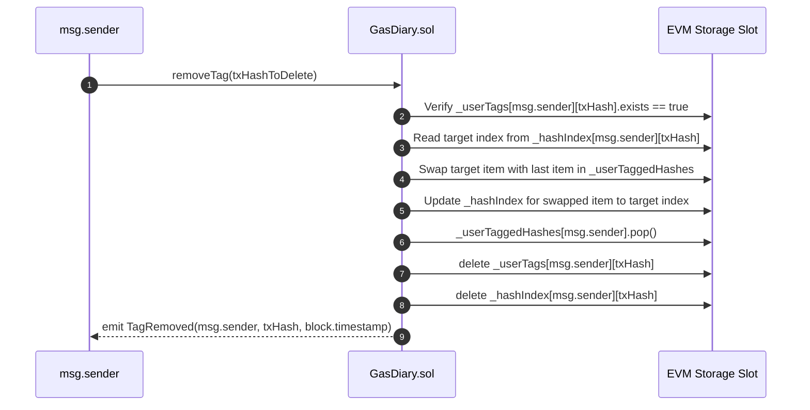

# GasDiary Whitepaper
**A Decentralized Protocol for On-Chain Gas Tracking, Expense Categorization, and Verifiable Transaction Metadata**

*Version 1.0.0 — November 2026*  
*Target Network: BOT Chain Mainnet (Chain ID: 677)*  
*Smart Contract: `GasDiary.sol` (`0x5a04E7558461121941eC2A52a019D6F577437A6C`)*

---

## Executive Summary

As decentralized application ecosystems expand across high-throughput Layer 1 and Layer 2 networks, transaction fee accounting, operational expense tracking, and post-execution annotation remain significant operational challenges for decentralized autonomous organizations (DAOs), Web3 developers, automated arbitrage bots, and active retail users.

Traditional blockchain explorers provide cryptographic finality and raw byte-level logs but fail to offer semantic context, financial classification, or user-owned verifiable memos. Web2 accounting tools require custody over API keys or centralized database storage, violating the core ethos of decentralized self-sovereignty.

**GasDiary** is a decentralized gas fee tracking and self-sovereign expense annotation protocol designed specifically for EVM-compatible ecosystems, launched natively on **BOT Chain Mainnet** (Chain ID: `677`). GasDiary integrates real-time block explorer indexers with a specialized smart contract (`GasDiary.sol`) and a high-performance client analytics engine. It provides:

1. **Automated Gas Accounting & Capital Leak Analysis**: Precise fee calculations ($\text{Fee} = \text{GasUsed} \times \text{GasPrice}$) in native BOT token and fiat equivalents, tracking successful calls, peak fee events, and capital lost to reverted transactions.
2. **Self-Sovereign On-Chain Annotation**: A decentralized registry enabling users to irrevocably bind semantic categories, transaction intent, and personal audit notes to their wallet address and specific transaction hashes.
3. **Dual-Persistence Engine**: Seamless switching between cryptographically verifiable on-chain storage and local privacy-preserving zero-cost offline storage.
4. **Automated Method Heuristics**: Automatic categorization of transactions into DeFi swaps, NFT mints, staking, token transfers, approvals, and contract deployments.
5. **Audit-Grade Compliance Export**: One-click generation of normalized, timestamped CSV records formatted for corporate treasuries, tax auditors, and bookkeeping frameworks.



---

## 1. The Problem Landscape

### 1.1 The Opacity of Blockchain Transaction Costs
On Ethereum Virtual Machine (EVM) platforms, computational execution and storage allocation are metered via *gas units*. The native asset fee expended is defined as:

$$\text{Fee}_{\text{native}} = \frac{\text{GasUsed} \times \text{GasPrice}_{\text{effective}}}{10^{18}}$$

While network explorers display this computation per individual block, users interacting across tens or hundreds of protocols each week face fragmented operational visibility:
- **Cumulative Fee Erosion**: Users fail to realize the percentage of their portfolio consumed by routine approvals, liquidity provision, and failed MEV attempts.
- **Wasted Capital on Reverts**: When a transaction fails (e.g., due to slippage, out-of-gas, or state contention), the gas fee is still entirely consumed by validators. Existing tools rarely isolate this "burnt capital" as a distinct operational loss.

### 1.2 Lack of Human-Readable Context in Ledgers
Blockchains record cryptographic intent (signatures, method selectors, raw bytecode inputs). However, financial accounting requires human-readable semantic context:
- Why was 50 BOT transferred to address `0x3344...`? Was it payroll, loan collateral, OTC settlement, or an accidental transfer?
- Why did transaction `0x8c9d...` burn 0.0055 BOT with zero output? Was it an intentional cancel/speedup, or an unhandled DEX slippage error?

### 1.3 The Limitations of Centralized Portfolio Trackers
Current Web3 portfolio and tax software platforms suffer from severe design trade-offs:
- **Centralized Silos**: Memos and tags are stored in centralized SaaS databases. If the platform goes offline or pivots, all historic financial annotations are permanently lost.
- **Privacy Intrusion**: Centralized servers index and associate wallet addresses with real-world identities, IP logs, and browser metadata.
- **No Native Support for Emerging EVM Chains**: Specialized EVM networks such as BOT Chain often lack support from legacy portfolio trackers, leaving users with no structured bookkeeping mechanisms.

---

## 2. The GasDiary Solution Architecture

GasDiary introduces a decentralized, non-custodial framework that bridges on-chain data indexers, an in-browser statistical processing core, and an immutable smart contract registry.

### 2.1 Architectural Pillars

```
+-------------------------------------------------------------------------+
|                          GasDiary Architecture                          |
+-------------------------------------------------------------------------+
|  1. User Presentation Layer (React 19, Wagmi v3, Reown AppKit)          |
|     - Real-Time Gas Metrics Cards (Total, Average, Wasted, Peak)         |
|     - Time-Series Gas Spending Charts (SVG Bar Charts, Dynamic Scaling) |
|     - Category Distribution Engine (Progressive Multi-Bar Breakdown)    |
|     - Searchable, Multi-Filter Transaction Log                          |
+-------------------------------------------------------------------------+
|  2. Semantic & Analytics Engine (TypeScript)                            |
|     - Method Signature Decoder & Heuristic Category Classifier          |
|     - Fee Aggregation & Time-Bucket Sorting                             |
|     - CSV Exporter with Deterministic Explorer Anchor Links             |
+-------------------------------------------------------------------------+
|  3. Data Acquisition & Dual-Persistence Layer                           |
|     - Primary: Blockscout v2 REST Indexer (scan.botchain.ai/api/v2)     |
|     - Secondary / Fallback: Deterministic Sample Dataset                |
|     - Storage Path A: On-Chain Registry via GasDiary.sol (Immutable)    |
|     - Storage Path B: Client LocalStorage (Zero-Gas Offline Fallback)   |
+-------------------------------------------------------------------------+
|  4. Blockchain Consensus & Execution Layer                              |
|     - BOT Chain Mainnet (Chain ID 677, BOT Native Token)                |
|     - Hardhat EVM Toolchain & Ethers v6 Deployment Engine               |
+-------------------------------------------------------------------------+
```

---

## 3. Smart Contract Specification: `GasDiary.sol`

At the protocol layer, `GasDiary.sol` functions as an autonomous, decentralized key-value and indexing registry for transaction metadata.

### 3.1 Data Structures

Each transaction annotation is encapsulated in the `TagRecord` struct:

```solidity
struct TagRecord {
    bytes32 txHash;      // 32-byte cryptographic transaction hash
    string category;     // Semantic category (e.g., "DeFi Swap", "NFT Mint")
    string note;         // User memo, tax note, or intent rationale
    uint256 updatedAt;   // Unix block timestamp of the latest write
    bool exists;         // Sentinel boolean for O(1) membership checks
}
```

### 3.2 State Variables & Access Boundaries
To ensure strict privacy and caller isolation, data access is partitioned by caller address:

```solidity
// userAddress => txHash => TagRecord
mapping(address => mapping(bytes32 => TagRecord)) private _userTags;

// userAddress => sequential array of tagged tx hashes for enumeration
mapping(address => bytes32[]) private _userTaggedHashes;

// userAddress => txHash => (1-based index in _userTaggedHashes; 0 = unmapped)
mapping(address => mapping(bytes32 => uint256)) private _hashIndex;
```

#### Key Architectural Properties:
- **User Isolation**: A user can only write, overwrite, or delete tags within their own storage slice (`msg.sender`). Even if two independent users annotate the same transaction hash, their notes and categories remain strictly isolated.
- **No Governance Bottlenecks**: The contract is permissionless and self-executing. No administrative key or contract owner can freeze, edit, or censor user records.

### 3.3 Protocol Functions & Complexity Analysis

| Function | Signature | Gas Complexity | Description |
|---|---|---|---|
| `tagTransaction` | `(bytes32, string, string)` | $\mathcal{O}(1)$ | Creates or updates an annotation for a single transaction hash. |
| `batchTagTransactions` | `(bytes32[], string[], string[])` | $\mathcal{O}(N)$ | Atomic batch tagging for $N$ transactions in a single block execution. |
| `removeTag` | `(bytes32)` | $\mathcal{O}(1)$ | Deletes an annotation and reorganizes index arrays using the swap-and-pop pattern. |
| `getUserTag` | `(address, bytes32)` | $\mathcal{O}(1)$ (view) | Returns category, note, timestamp, and existence flag for a specific transaction. |
| `getUserTaggedHashes` | `(address)` | $\mathcal{O}(K)$ (view) | Enumerates all tagged transaction hashes belonging to a user. |
| `getUserTagsBatch` | `(address, bytes32[])` | $\mathcal{O}(M)$ (view) | Batch queries $M$ records in a single read call, eliminating RPC round-trip latency. |
| `getUserTagCount` | `(address)` | $\mathcal{O}(1)$ (view) | Returns total count of transactions tagged by a user. |

### 3.4 Gas-Optimized Swap-and-Pop Deletion
Standard array deletion in Solidity either leaves zeroed "holes" or requires shifting all subsequent elements ($\mathcal{O}(N)$ gas). `GasDiary.sol` implements an $\mathcal{O}(1)$ swap-and-pop algorithm utilizing `_hashIndex`:



---

## 4. Mathematical Modeling & Analytics Engine

The GasDiary client implements an in-memory aggregation engine that computes multi-dimensional spending metrics without external server reliance.

### 4.1 Aggregate Gas Computation
Given a transaction set $\mathcal{T} = \{t_1, t_2, \dots, t_n\}$, where each transaction $t_i$ possesses gas consumption $g_i$, effective gas price $p_i$, and execution status $s_i \in \{\text{ok}, \text{error}\}$:

$$\text{Fee}(t_i) = \frac{g_i \times p_i}{10^{18}}$$

$$\text{TotalGasFees}(\mathcal{T}) = \sum_{i=1}^{n} \text{Fee}(t_i)$$

$$\text{AverageFee}(\mathcal{T}) = \frac{1}{n} \sum_{i=1}^{n} \text{Fee}(t_i)$$

### 4.2 Wasted Capital Metric (Failed Transactions)
Transactions that abort during execution (reverting due to require violations, insufficient gas limit, or state assertion failures) consume gas without completing their business logic. GasDiary isolates this metric:

$$\mathcal{T}_{\text{failed}} = \{t_i \in \mathcal{T} \mid s_i = \text{error}\}$$

$$\text{WastedCapital} = \sum_{t_k \in \mathcal{T}_{\text{failed}}} \text{Fee}(t_k)$$

$$\text{CapitalLossRatio} = \frac{\text{WastedCapital}}{\text{TotalGasFees}(\mathcal{T})}$$

### 4.3 Peak Transaction Identification
To highlight volatile network spikes or inefficient contract calls:

$$t_{\text{peak}} = \arg\max_{t_i \in \mathcal{T}} \text{Fee}(t_i)$$

### 4.4 Heuristic Classification Engine
Incoming transactions from the Blockscout v2 indexer are parsed through deterministic heuristic rules to assign standard default categories prior to user customization:

$$\text{Category}(t) = \begin{cases}
\text{"Contract Deployment"} & \text{if } t.\text{to} = \emptyset \\
\text{"DeFi Swap"} & \text{if } \text{method} \ni \{\text{swap}, \text{swapExact}, \text{exchange}\} \\
\text{"NFT Mint"} & \text{if } \text{method} \ni \{\text{mint}, \text{claimNFT}\} \\
\text{"Staking / Yield"} & \text{if } \text{method} \ni \{\text{stake}, \text{deposit}, \text{harvest}, \text{withdraw}\} \\
\text{"DAO Governance"} & \text{if } \text{method} \ni \{\text{vote}, \text{propose}, \text{execute}\} \\
\text{"Approval / Revoke"} & \text{if } \text{method} \ni \{\text{approve}, \text{permit}, \text{revoke}\} \\
\text{"Token Transfer"} & \text{if } \text{method} \ni \{\text{transfer}, \text{transferFrom}\} \\
\text{"Other"} & \text{otherwise}
\end{cases}$$

---

## 5. Network Specifications & BOT Chain Integration

GasDiary is engineered natively for the **BOT Chain** ecosystem, operating against its high-performance EVM infrastructure on BOT Chain Mainnet.

### 5.1 BOT Chain Mainnet Parameters

| Parameter | Specification |
|---|---|
| **Consensus Mechanism** | Proof-of-Stake (PoS) / EVM |
| **Network Name** | BOT Chain Mainnet |
| **Chain ID** | `677` |
| **Native Currency** | BOT |
| **Decimals** | 18 |
| **Total Supply** | 150 Million BOT |
| **JSON-RPC Endpoint** | `https://rpc.botchain.ai` |
| **Block Explorer** | `https://scan.botchain.ai` |
| **Blockscout Indexer API** | `https://scan.botchain.ai/api/v2` |
| **Deployed Contract** | [`0x5a04E7558461121941eC2A52a019D6F577437A6C`](https://scan.botchain.ai/address/0x5a04E7558461121941eC2A52a019D6F577437A6C?tab=contract) *(Verified)* |

### 5.2 Indexer Fallback Architecture
Network indexer availability can occasionally fluctuate. GasDiary implements a 3-layer resilient fetching pipeline:
1. **Primary**: REST API call to Blockscout v2 address transactions endpoint.
2. **Transform**: Normalization of wei gas units into formatted BOT and Gwei values.
3. **Resilience Fallback**: If the remote indexer is temporarily unreachable or the wallet is newly created with 0 transactions, GasDiary seamlessly activates **Demo Mode** with realistic transaction topologies, allowing complete evaluation of the visualizer, chart engine, and tag modal without friction.

---

## 6. Audit-Ready Bookkeeping & CSV Export

For corporate accounting, decentralized treasuries, and personal tax reporting, GasDiary features a standards-compliant CSV export engine.

### 6.1 Data Schema

```
Date & Time (UTC) | Tx Hash | Block Number | Status | Method / Interaction | Category | Personal Note | Value (BOT) | Gas Used | Gas Price (Gwei) | Fee Paid (BOT) | From | To | Explorer Link
```

### 6.2 Key Features of the Export Framework
- **RFC 4180 Compliant**: Double-quote escaping across all text fields prevents formula injection and CSV delimiter breakage.
- **Cryptographic Traceability**: Every row is hyperlinked directly to the canonical BOT Chain Explorer record (`https://scan.botchain.ai/tx/{hash}`).
- **Zero Intermediaries**: The CSV generation occurs purely client-side via in-memory Blob creation, guaranteeing that no transaction data or IP addresses are logged by third-party servers.

---

## 7. Security, Privacy & Threat Analysis

### 7.1 Smart Contract Security
- **Reentrancy Immunity**: `GasDiary.sol` does not hold, transfer, or receive native ether/BOT or ERC-20 tokens. State changes are purely internal mappings.
- **Arithmetic Safety**: Compiled with Solidity `^0.8.20`, providing native overflow and underflow checks.
- **Boundary Validation**: Non-zero transaction hash assertions (`require(txHash != bytes32(0))`) and category string length checks ensure data integrity.
- **Unit Test Coverage**: Comprehensive Hardhat test suite (`test/GasDiary.test.cjs`) verifying single tagging, batch processing, caller segregation, and swap-and-pop removal routines.

### 7.2 Data Privacy Options
Users have complete autonomy over their metadata visibility:
- **On-Chain Mode**: Notes and categories are committed to `GasDiary.sol`. They are permanent, censorship-resistant, and verifiable by third-party smart contracts and auditors.
- **Local Mode**: Notes are committed directly to browser `localStorage`. No gas is expended, and metadata remains strictly confidential to the user's local machine.

---

## 8. Development Roadmap

| Phase | Milestone | Key Deliverables |
|---|---|---|
| **Phase 1 (Q4 2026)** | Mainnet Protocol Launch | `GasDiary.sol` on BOT Chain Mainnet, Live Gas Dashboard, Blockscout v2 API integration, CSV Exporter |
| **Phase 2 (Q1 2027)** | Gas Alerts & Bulk Annotations | Real-time gas price threshold alerts, Bulk transaction tagging UI |
| **Phase 3 (Q2 2027)** | Multi-Chain & Treasury Tools | Expansion to Ethereum L2s, Safe multisig plugin for DAO treasuries, AI-driven heuristic intent classification |
| **Phase 4 (Q3 2027)** | Privacy & Mobile Client | Zero-knowledge on-chain encrypted notes (ZK-Notes), Mobile PWA with push notifications |

---

## 9. Conclusion

GasDiary establishes a critical infrastructure standard for EVM expense tracking and transaction provenance. By uniting real-time blockchain indexers, an intuitive browser-based analytics suite, and a decentralized, self-sovereign smart contract registry on BOT Chain Mainnet, GasDiary converts opaque hexadecimal transaction fees into structured, actionable, and permanent financial records.

---

### Technical Inquiries & Repository
- **Network**: BOT Chain Mainnet (Chain ID: `677`)
- **Block Explorer**: [scan.botchain.ai](https://scan.botchain.ai)
- **RPC**: [rpc.botchain.ai](https://rpc.botchain.ai)
- **License**: MIT
